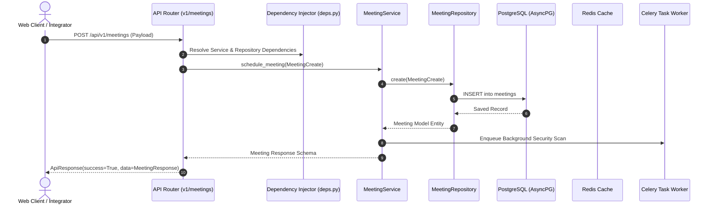
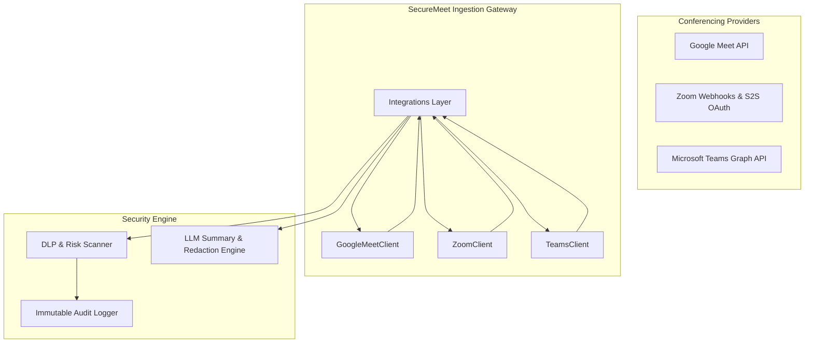

# SecureMeet AI — Architectural Specification

## 1. System Vision & Domain Boundaries

**SecureMeet AI** is an enterprise-grade AI-powered meeting security and governance platform. It sits as a guardian layer between enterprise collaboration platforms (**Google Meet**, **Zoom**, **Microsoft Teams**) and internal compliance policies, providing:
- Real-time attendee verification and meeting access control.
- In-meeting Data Loss Prevention (DLP) and screen sharing security rules.
- Automatic PII/secret redaction and AI meeting summarization.
- Tamper-evident immutable SOC-2 / ISO-27001 audit logging.
- Deep security posture analytics.

---

## 2. Clean Architecture & Separation of Concerns

The backend follows **Clean Architecture** principles. Dependencies flow inwards:

```
[ HTTP Requests / Controllers / Routers ]
                  │
                  ▼
         [ Service Layer ]  <─────  Business Rules, Policy Validation
                  │
                  ▼
       [ Repository Layer ]  <─────  Data Access Abstraction (SQLAlchemy 2.0 Async)
                  │
                  ▼
     [ Domain Models & Database ]
```

### Architectural Guardrails:
1. **Controllers / Routers**: Zero business logic and zero direct database queries. Their sole responsibility is parameter validation, HTTP status codes, and invoking injected services.
2. **Service Layer**: Houses domain orchestration, policy evaluations, and external API calls. Never writes raw SQL; communicates exclusively through repositories.
3. **Repository Layer**: Encapsulates persistence logic, query building, and filtering behind abstract interfaces.
4. **Domain Models**: Declarative SQLAlchemy models containing relational schemas and audit metadata.
5. **API Contracts**: Pydantic v2 schemas strictly validate incoming payloads and enforce an enterprise response envelope (`ApiResponse[T]`).

---

## 3. Component Interaction Flow



---

## 4. Multiplatform Integration Architecture



---

## 5. Security & Authentication Architecture

- **Token Lifecycle**: Short-lived Access Tokens (30m JWT) paired with cryptographically secure, rotating Refresh Tokens (7d) persisted in Redis with immediate revocation capabilities.
- **RBAC**: Hierarchical role-based access control with fine-grained permission string evaluation (`meetings:read`, `security:policies:manage`).
- **Data Protection**: AES-256 for credentials in transit and rest; strict PII masking applied prior to indexing transcripts.
